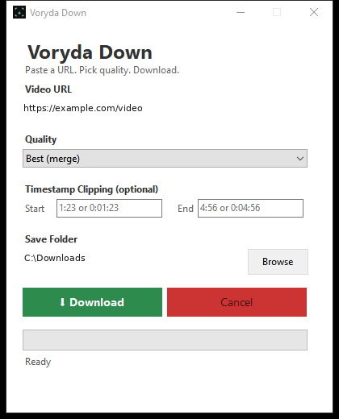

  <picture>
    <source media="(prefers-color-scheme: dark)" srcset="https://raw.githubusercontent.com/smouj/voryda-down/main/assets/logo-dark.png?v=4f13fad2ad34f1086d4275045e30e6ec832cca22d27448ff84ec0b835fb0a65f">
    <source media="(prefers-color-scheme: light)" srcset="https://raw.githubusercontent.com/smouj/voryda-down/main/assets/logo.png?v=4f13fad2ad34f1086d4275045e30e6ec832cca22d27448ff84ec0b835fb0a65f">
    
  </picture>

<h1 align="center">Voryda Down</h1>

  <strong>Paste a media URL, choose a format and download.</strong>

  
  
  
  
  

  <a href="#overview">Overview</a> ·
  <a href="#features">Features</a> ·
  <a href="#project-status">Status</a> ·
  <a href="#build-from-source">Build</a> ·
  <a href="#privacy">Privacy</a>

## Overview

**Voryda Down** is a native Windows front end for [yt-dlp](https://github.com/yt-dlp/yt-dlp). The C# and .NET 8 Windows Forms app provides a focused workflow for HTTP or HTTPS media URLs, quality selection, optional time ranges and local downloads. It launches yt-dlp as a child process and reports progress when yt-dlp provides it.

**yt-dlp is required and is not included in this repository.** FFmpeg is optional for workflows that need stream merging or media processing. Both are separate tools with their own licenses.

## Features

- Download a video using Best, 1080p, 720p or 480p quality options.
- Save the best available audio stream in M4A format.
- Set optional start and end timestamps using seconds, <code>MM:SS</code> or <code>HH:MM:SS</code>.
- View progress, speed and estimated time when yt-dlp reports those values.
- Cancel an active download.
- Keep playlists disabled; each operation targets a single item.
- Minimize the app to the system tray and restore it later.

## Project status

The project metadata declares version **1.0.0**. No public GitHub Release or release download is available yet.

## Screenshot

*The screenshot shows the current Windows application.*

## Runtime dependencies

The app looks for its command-line tools in this order:

| Tool | Lookup locations |
| --- | --- |
| <code>yt-dlp.exe</code> | Application folder, <code>extraResources</code> folder, then system <code>PATH</code> |
| <code>ffmpeg.exe</code> | Application folder, <code>extraResources</code> folder, then system <code>PATH</code> |

Place the executables in one of those locations before using the corresponding workflow. yt-dlp is required for downloads. FFmpeg is needed when the selected streams or processing path require it.

The available streams and extraction behavior depend on the source service and the installed yt-dlp version.

## Usage

1. Enter an HTTP or HTTPS media URL.
2. Select a video quality or **Audio only (M4A)**.
3. Optionally set a start and end time.
4. Choose the destination folder.
5. Start the download. Use **Cancel** to stop the active operation.

Timestamp examples:

    83
    1:23
    0:01:23

## Local data

| Item | Location or default |
| --- | --- |
| Settings | <code>%APPDATA%\AreaDown\settings.json</code> |
| Default download folder | <code>%USERPROFILE%\Downloads</code> |
| Remembered values | Last URL, quality and destination folder |

The <code>AreaDown</code> settings path and internal project names are retained for compatibility while the public product name is Voryda Down.

## Requirements

- Windows 10 version 2004 (build 19041) or later, or Windows 11.
- .NET 8 Desktop Runtime to run a framework-dependent build.
- .NET 8 SDK to build from source.
- yt-dlp for all downloads; FFmpeg for workflows that require merging or processing.

## Build from source

    git clone https://github.com/smouj/voryda-down
    cd voryda-down
    dotnet build -c Release
    dotnet run --project src\AreaDown.App\AreaDown.App.csproj

Create a self-contained Windows x64 build:

    dotnet publish src\AreaDown.App -c Release -r win-x64 --self-contained

This repository keeps its product and developer guidance in this README.

## Privacy and responsible use

Voryda Down stores settings locally and has no account system or application telemetry in the current code. Downloading is a network operation: yt-dlp connects to the URL and may contact services required by the source site.

Use the app only for content you are authorized to download. yt-dlp and FFmpeg are independent projects and are distributed under their own licenses.

## License

Voryda Down is distributed under the [MIT License](LICENSE).

---

  <strong>Voryda</strong> 
  Focused Windows utilities.

  <a href="https://github.com/smouj/voryda-snap">Snap</a> ·
  <a href="https://github.com/smouj/voryda-rec">Rec</a> ·
  <a href="https://github.com/smouj/voryda-down">Down</a> ·
  <a href="https://github.com/smouj/voryda-cut">Cut</a>

