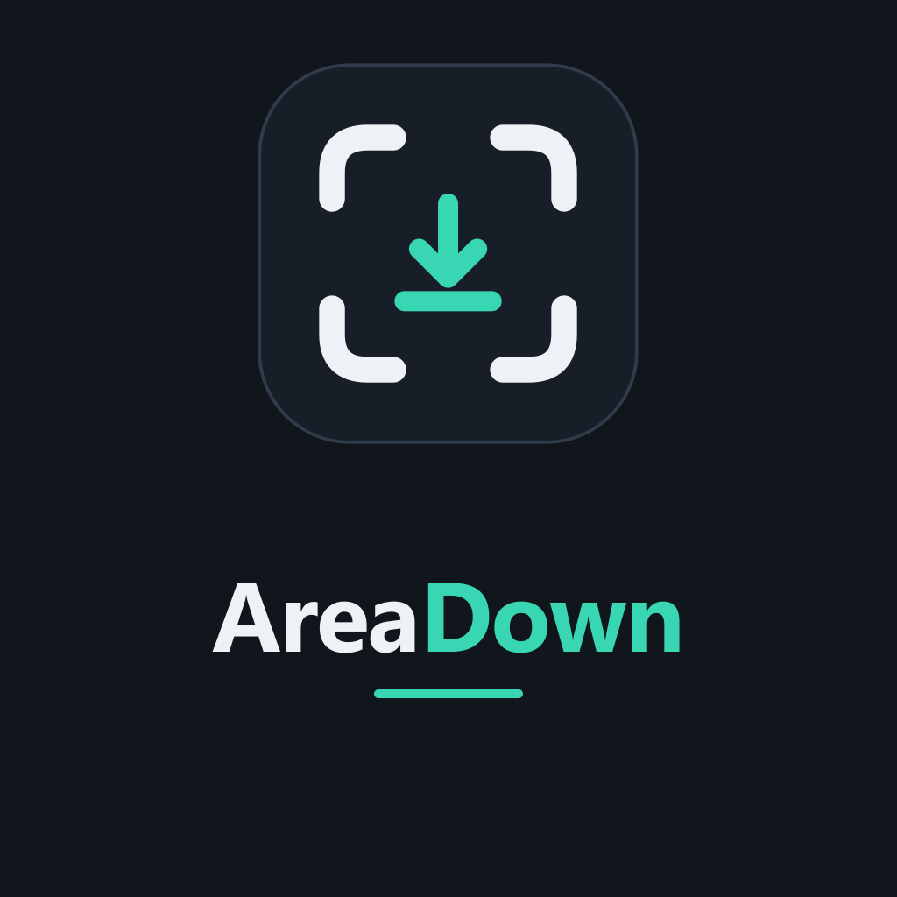

<p align="center">
  <picture>
    <source media="(prefers-color-scheme: dark)" srcset="assets/logo-dark.png">
    <source media="(prefers-color-scheme: light)" srcset="assets/logo.png">
    
  </picture>
</p>

<h1 align="center">Voryda Down</h1>

<p align="center">
  <strong>Paste a URL. Pick a format. Download.</strong>
</p>

<p align="center">
  
  
  
  
  
  
</p>

<p align="center">
  <a href="#overview">Overview</a> ·
  <a href="#current-status">Status</a> ·
  <a href="#usage">Usage</a> ·
  <a href="#build-from-source">Build</a> ·
  <a href="#privacy-and-network-use">Privacy</a>
</p>

## Overview

**Voryda Down** is a compact Windows front end for downloading media through **yt-dlp**, with **FFmpeg** available for format merging and media processing. It keeps the common workflow in one window: enter a URL, select a quality preset, optionally define a time range, choose a destination and start the download.

The desktop application is written in C# with .NET 8 and WinForms. It tracks progress reported by yt-dlp, supports cancellation, remembers the last URL, quality and destination folder, and moves to the system tray when minimized.

## Current status

The repository declares version **1.0.0**. There is currently no GitHub Release published for this repository.

| Capability | State | Notes |
| --- | --- | --- |
| HTTP/HTTPS URL input | **Implemented** | Input is validated before a download starts. |
| Video download | **Implemented** | Runs yt-dlp as a local child process. |
| Quality presets | **Implemented** | Best/1080p, 720p and 480p. |
| Audio-only mode | **Implemented** | Requests the best audio stream and uses M4A as the merge format. |
| Timestamp selection | **Implemented** | Accepts seconds, `MM:SS` or `HH:MM:SS`. |
| Download progress | **Implemented** | Percentage, speed and ETA are parsed from yt-dlp output when available. |
| Cancellation | **Implemented** | Terminates the running yt-dlp process tree. |
| System tray | **Implemented** | The window hides to the tray when minimized; the tray menu can restore or exit. |
| Global keyboard shortcut | **Not implemented** | The current application code does not register one. |
| Playlists | **Disabled** | Downloads are started with `--no-playlist`. |
| GitHub Release | **Not published** | No release asset is currently available from GitHub Releases. |

## Quality presets

| UI option | Download rule |
| --- | --- |
| **Best (merge)** | Best compatible video up to 1080p plus best audio, with fallbacks. |
| **1080p** | Best compatible video up to 1080p plus best audio, with fallbacks. |
| **720p** | Best compatible video up to 720p plus best audio, with fallbacks. |
| **480p** | Best compatible video up to 480p plus best audio, with fallbacks. |
| **Audio only (m4a)** | Best available audio stream; merge format set to M4A. |

The exact streams available are determined by the source site and yt-dlp.

## Usage

1. Paste an HTTP or HTTPS media URL.
2. Choose the desired quality preset.
3. Optionally enter a **Start** time and an **End** time.
4. Select the destination folder.
5. Press **Download**.
6. Use **Cancel** if the current operation needs to be stopped.

Timestamp examples:

```text
83
1:23
0:01:23
```

When a time range is provided, Voryda Down passes the range to yt-dlp through `--download-sections` and requests keyframes at cuts.

## Runtime dependencies

Voryda Down searches for its command-line tools in this order:

| Tool | Lookup |
| --- | --- |
| `yt-dlp.exe` | Application folder → `extraResources` → system `PATH` |
| `ffmpeg.exe` | Application folder → `extraResources` → system `PATH` |

**yt-dlp is required** to start a download. FFmpeg is used by yt-dlp when merging or processing formats that require it.

## Local data

| Item | Location / default |
| --- | --- |
| Settings | `%APPDATA%\AreaDown\settings.json` |
| Default download folder | `%USERPROFILE%\Downloads` |
| Default quality | Best |
| Remembered values | Last URL, last quality and save folder |

The `AreaDown` settings path and internal project names are retained for compatibility while the public product name moves to **Voryda Down**.

## Architecture

| Project | Responsibility |
| --- | --- |
| `AreaDown.App` | WinForms interface, local settings, validation, tray lifecycle and download orchestration. |
| `AreaDown.Core` | Download settings, quality mapping, timestamp range and format models. |
| `AreaDown.Downloader` | yt-dlp process wrapper, progress parser and FFmpeg clip-processing helper. |

## Requirements

- Windows 10 version 2004 (build 19041) or later, or Windows 11.
- .NET 8 runtime for a framework-dependent build.
- `yt-dlp.exe` available beside the application or on `PATH`.
- FFmpeg available beside the application or on `PATH` for workflows that require merging or media processing.
- .NET 8 SDK only when building from source.

## Build from source

```powershell
git clone https://github.com/smouj/areadown
cd areadown
dotnet build -c Release
```

Run the desktop application:

```powershell
dotnet run --project src\AreaDown.App\AreaDown.App.csproj
```

Create a self-contained Windows x64 build:

```powershell
dotnet publish src\AreaDown.App -c Release -r win-x64 --self-contained
```

For a runnable local package, place `yt-dlp.exe` and, when needed, `ffmpeg.exe` next to the published executable or make them available through `PATH`.

## Privacy and network use

Voryda Down stores its own preferences locally and contains no account system or application telemetry in the current code. Downloading media is inherently a network operation: the application launches yt-dlp, which connects to the URL and services required to retrieve the requested media.

Use Voryda Down only for content you are permitted to download. Site support and extraction behavior depend on the installed yt-dlp version and the source service.

## License

The Voryda Down source code is distributed under the **MIT License**. See [LICENSE](LICENSE). yt-dlp and FFmpeg are separate projects distributed under their own licenses.

---

<p align="center">
  <strong>Voryda</strong><br>
  Focused Windows utilities.
</p>

<p align="center">
  <a href="https://github.com/smouj/areasnap">Snap</a>
  ·
  <a href="https://github.com/smouj/arearec">Rec</a>
  ·
  <a href="https://github.com/smouj/areadown">Down</a>
  ·
  <a href="https://github.com/smouj/areacut">Cut</a>
</p>
